# Visitor Sign-In

A visitor sign-in kiosk for any business's lobby tablet. It runs as an **Android app** or in a browser (iPad or any tablet). A short **setup wizard** makes it yours: your company name, logo and colors, an admin PIN, your NFC/RFID visitor badges, where records are kept, and optional **screening questions** that can politely decline a visitor, alert your staff and still be overridden by an admin.

**Version 1.1.0** · [Launch checklist](docs/LAUNCH.md) · [Releases](../../releases) (Android app, browser kiosk, backend script) · [Changelog](CHANGELOG.md) · [Privacy notice template](docs/privacy-notice.md) · [Selling it: the paywall](docs/PAYWALL.md)

| | | |
|---|---|---|
| 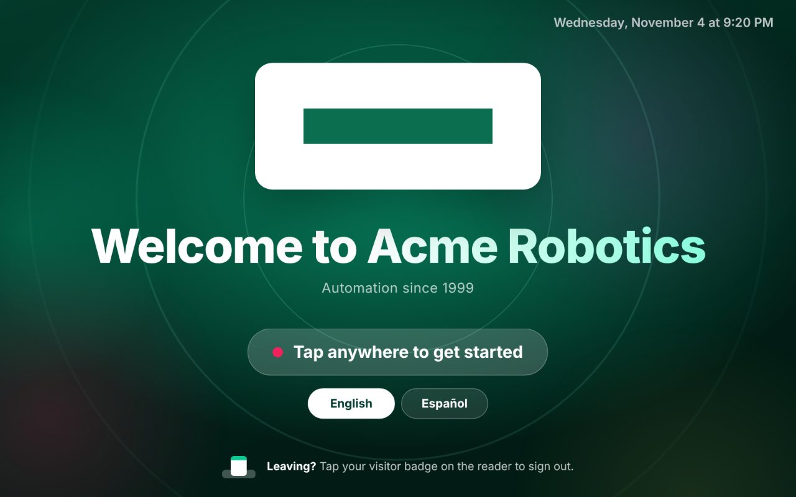 | 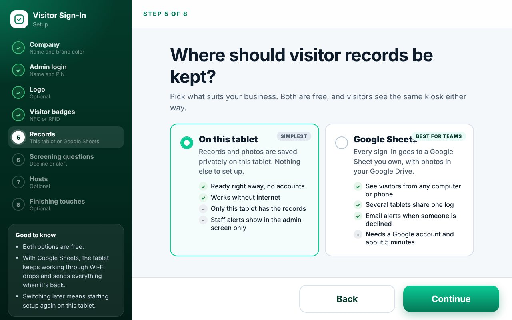 | 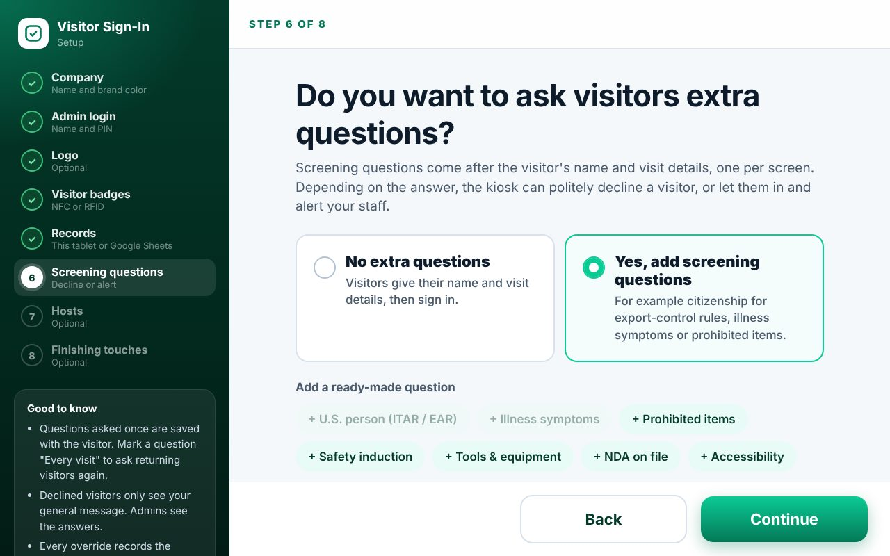 |
| Welcome screen, in your colors | Setup: on the tablet or in Google Sheets | Setup: screening questions |
| 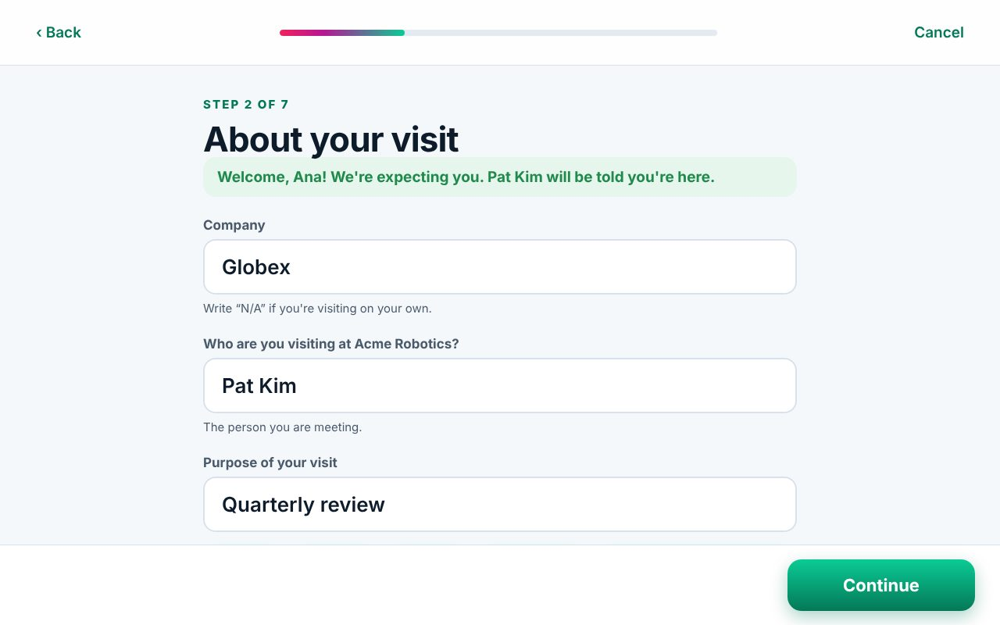 | 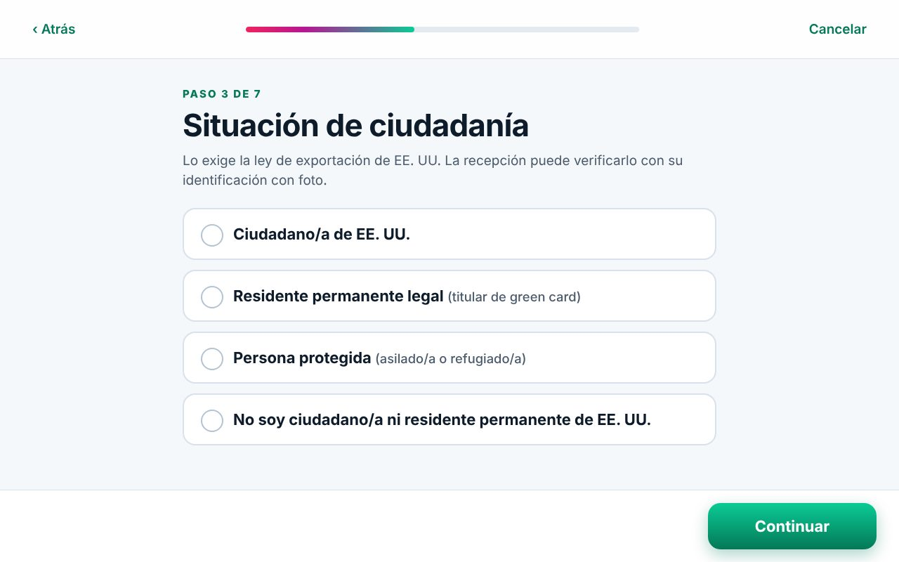 | 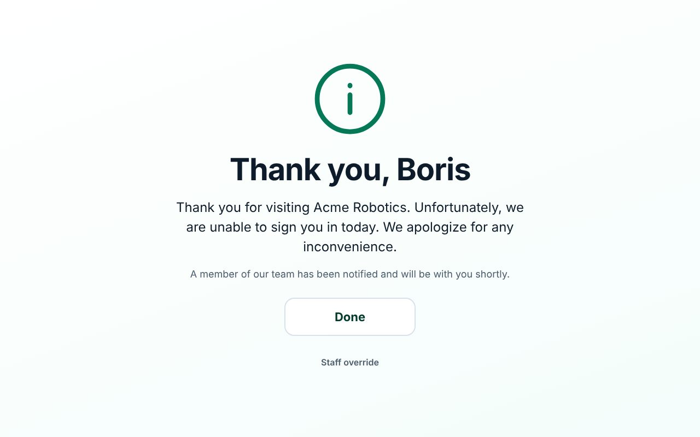 |
| Expected visitors are greeted | Spanish for visitors | A polite decline, with staff alerted |
| 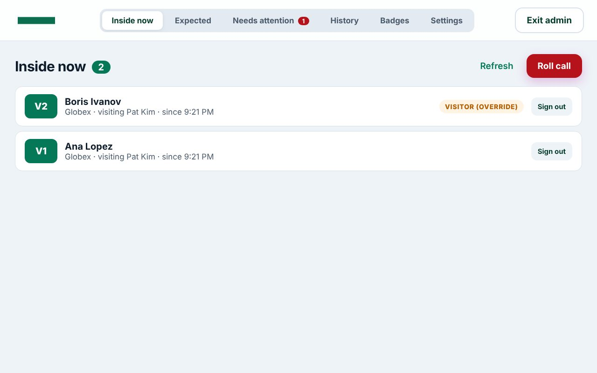 | 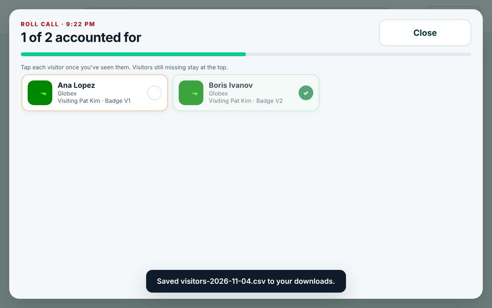 | 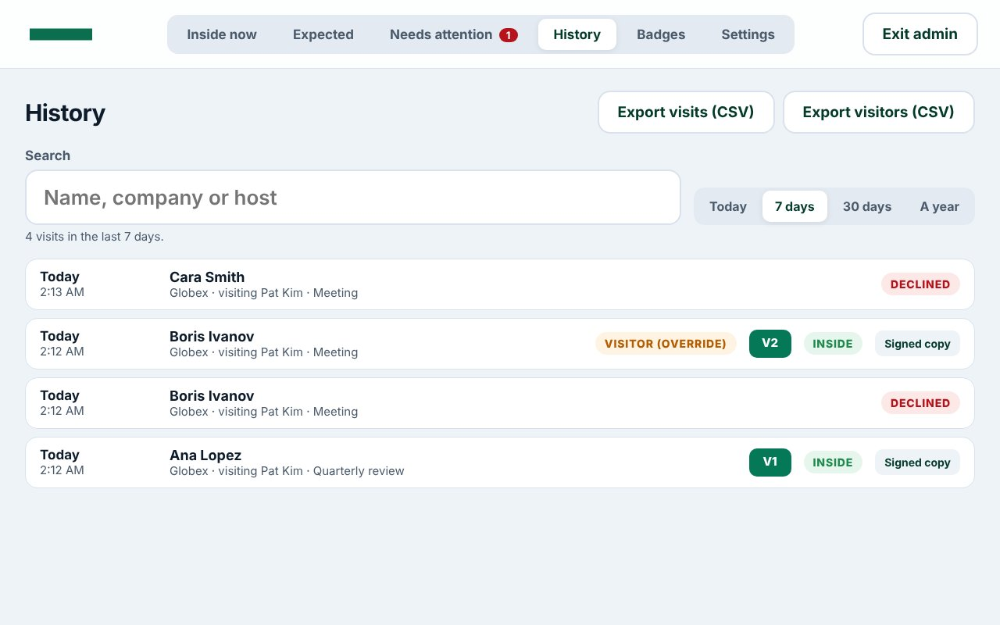 |
| Admin: who's inside | Emergency roll call | History and CSV export |
| 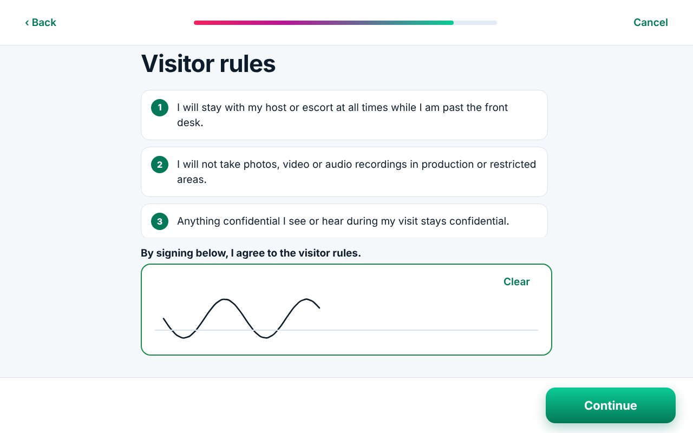 | 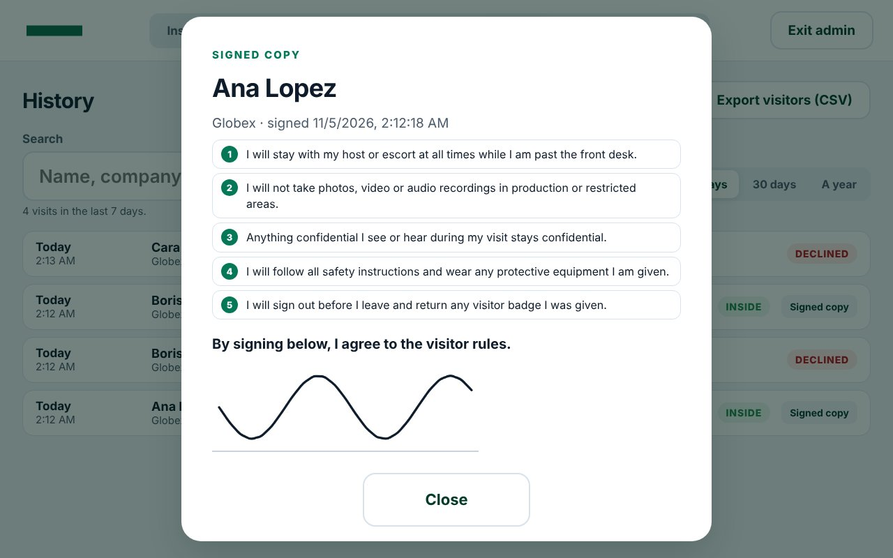 | 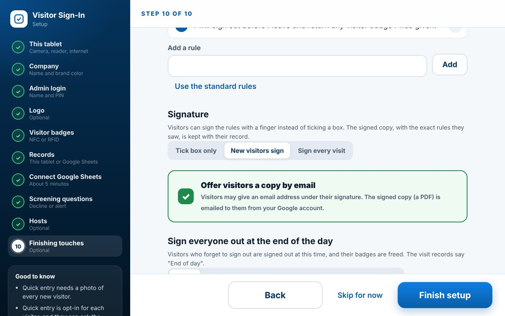 |
| Visitors sign the rules with a finger | The signed copy, as the visitor saw it | Setup: who signs, and an emailed copy |
| 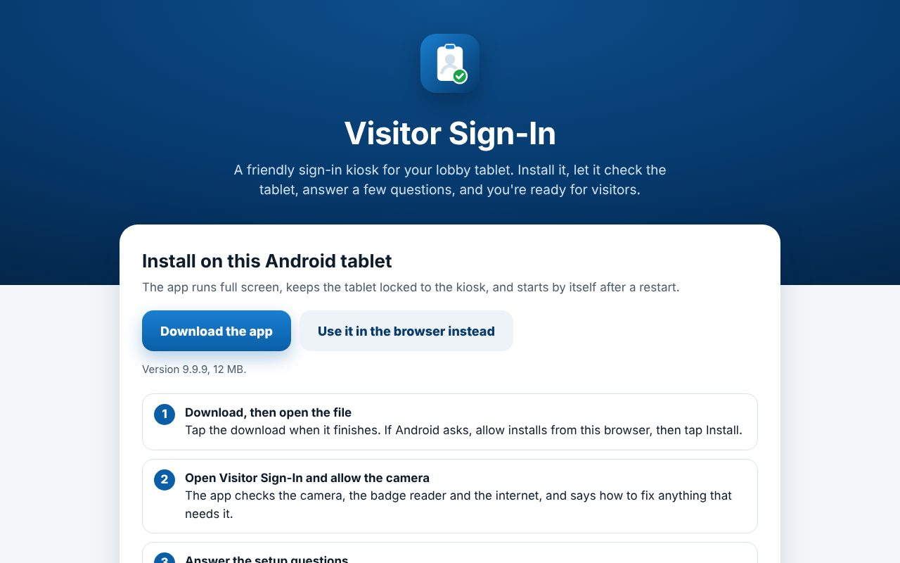 | 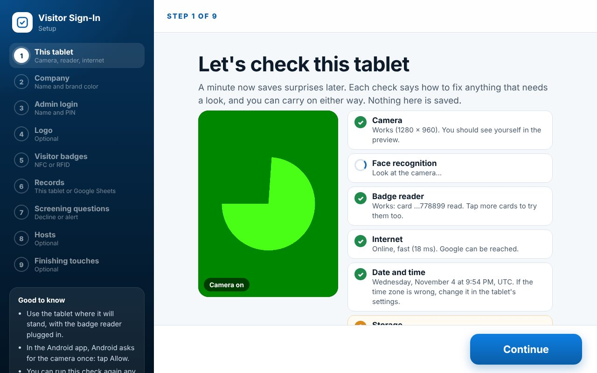 | 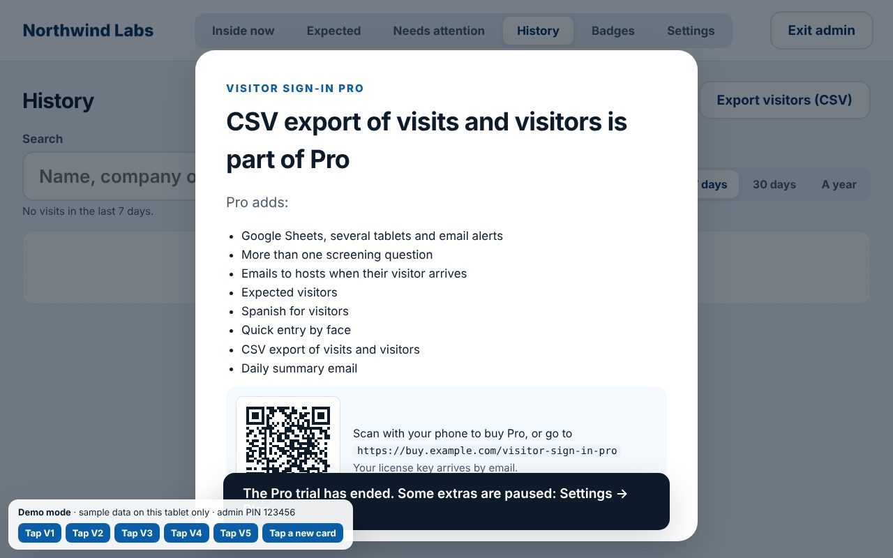 |
| The install page knows the device | Setup checks the tablet first | Ready to sell: plans and licenses |

```
web/           the kiosk (static HTML/CSS/JS, no build step)
android/       the Android app that wraps web/ (guide: android/README.md)
apps-script/   the Google Sheets backend (Apps Script), used when records go to Google Sheets
scripts/       build-android.mjs builds the APK; sync-backend.mjs bundles the backend into the wizard
tests/         backend tests, file checks, and an end-to-end browser test
docs/          launch checklist, privacy notice template, presets, screenshots, project history
media/         product demo videos; downloads/ an earlier demo build of the app
tools/         icon rendering (tools/icons/) and the demo video kit (tools/demo-video/)
```

How it was designed, and why, is in [docs/PROJECT_HISTORY.md](docs/PROJECT_HISTORY.md).

## Getting started

1. **Try it:** `npm start`, then open `http://localhost:8080/web/?demo` (sample company, a panel that simulates badge taps, admin PIN `123456`, nothing saved).
2. **Install it:** open the kiosk's address on the tablet (with GitHub Pages, `https://<owner>.github.io/<repository>/`). The install page recognizes the device: an Android tablet gets the latest app to download, an iPad gets the kiosk and the Add to Home Screen steps, and a computer shows a QR code to scan with the tablet.
3. **Set it up:** the first setup step checks the tablet (camera, face recognition, badge reader, internet, clock, storage, screen and software) and says how to fix anything. Then a few questions, and you're ready. The [launch checklist](docs/LAUNCH.md) has every step.

## Setup: the first start

Open the kiosk on the tablet. The first time, it opens the setup wizard (about 5 minutes, or 10 with Google Sheets):

| Step | What you choose |
|---|---|
| **0. This tablet** | Not a question: a check of the camera (with a live preview), face recognition, the badge reader (tap a card), the internet and Google, the clock and time zone, storage, the screen and the software, each with a plain-language fix. Run it again any time from Admin → Settings → Diagnostics. |
| **1. Company** | Name, a tagline, and one brand color. Every screen's colors are worked out from it, with a live preview. |
| **2. Admin login** | The admin's name and a 6 to 8 digit PIN. The PIN is only stored as a one-way hash. Easy PINs like `123456` are refused. |
| **3. Logo** | A PNG with a transparent background. The wizard checks the transparency and shrinks large files. No logo? A clean text logo in your color is made for you. |
| **4. Visitor badges** | Use NFC/RFID badges, or none. With badges, tap each card on the reader right there: they're numbered V1, V2, … Without badges, visitors sign out on the screen ("Leaving?"). |
| **5. Records** | **On this tablet** (private, nothing to set up) or **Google Sheets** (a live sheet your team can open anywhere, photos in your Google Drive, several tablets on one sheet). |
| **6. Connect Google Sheets** | Only with Google Sheets. Step-by-step instructions: make a sheet, paste the script (the wizard copies or downloads it for you), deploy it, and paste the web app URL. The wizard tests the connection and explains any problem. |
| **7. Screening questions** | Optional. Pick ready-made questions (U.S. person for ITAR/EAR, illness symptoms, prohibited items, safety induction, tools, NDA, accessibility) or write your own (yes/no, multiple choice or short answer). For each one: which answers **politely decline** the visitor or **let them in and alert staff**, and whether it's asked once or on every visit. Choose the decline message, and with Google Sheets, who gets alert emails. |
| **8. Hosts** | Optional. The people visitors come to see, with their email addresses. Their names come up as visitors type. With Google Sheets, each host gets an email the moment their visitor signs in ("Your visitor has arrived"), and the visitor is told "We've let Pat know you're here." |
| **9. Finishing touches** | Photos (every visitor, only declined visitors, or none), face-recognition quick entry, visit reasons and visitor rules. **Signatures**: a tick box, or visitors sign the rules with a finger (new visitors, or every visit), with an emailed copy on request (Google Sheets). An optional daily **end-of-day** sign-out, with a **daily summary email** (Google Sheets). How long to **keep records** before they're deleted automatically. **Languages**: offer Spanish, and translate your own questions and rules. |

The last screen sums everything up and lists what to do next. Everything can be changed later: **press and hold the logo on the welcome screen for 2.5 seconds**, enter the PIN, then **Settings**.

Setting up another tablet: export the settings from Admin → Settings and import them on the first step, or, with Google Sheets, use **Connect another tablet** to get a private link that connects it to the same sheet and settings.

## What visitors see

1. **Welcome screen** with your logo, name and tagline. Tap anywhere to start, or tap **Español** to do everything that follows in Spanish.
2. **New visitor** or **Returning visitor**.
3. **New visitors** answer one screen at a time: name; company, who they're visiting (matching hosts are suggested as they type) and why (if staff are expecting them, they're greeted and these are filled in); your screening questions; a photo; the visitor rules (a tick box, or signed with a finger); and an opt-in for quick entry next time.
4. **Returning visitors** start typing their name. If they opted into quick entry, the camera may recognize them first. Questions marked "every visit" are asked again, and the rules are signed again if signatures are set to every visit.
5. **Finish:** tap any visitor badge on the reader, or (without badges) they're signed in straight away.
6. **Leaving:** tap the badge on the reader at the welcome screen, or tap **Leaving?** and find their name. "Not you? Undo" stays up for a few seconds. A badge marked "not returned" (see End of day) is cleared when it's tapped.

### Declined visitors

When an answer is set to decline (for example "Not a U.S. citizen or permanent resident"):

- The visitor still takes their picture (unless photos are off), then sees your polite message, "A member of our team has been notified", and nothing about why.
- The visit is recorded as **Declined**, with the answers and the photo. A red dot appears on the welcome screen, the visit shows in **Admin → Needs attention**, and with Google Sheets an alert email (with the photo) goes to the addresses you chose.
- **Overriding:** a staff member can tap **Staff override** on the decline screen, enter the PIN and a reason, and the visitor finishes signing in. Or, in **Needs attention**, **Let in** lets that visitor sign in normally at the kiosk for the next two hours. Either way the admin's name and reason are saved with the visit, which shows as "Visitor (override)". Later visits by the same person note "Visitor (approved earlier)".

Answers set to **let in and alert** sign the visitor in, mark the visit (for example "Needs induction"), and alert staff the same way. Answers to questions asked only once keep applying on later visits.

### Signatures

Choose in setup (Finishing touches → Signature) whether the rules are agreed with a tick box or signed:

- **New visitors sign** the rules once, at their first visit; that signed copy goes with their record and their first visit.
- **Every visit:** returning visitors are shown the rules and sign again each time.

Visitors sign with a finger in the box under the rules, with **Clear** to start over. A tap or a dot isn't accepted as a signature. What's kept is the rules exactly as the visitor saw them (in their language, with your company name filled in), the statement they signed, their signature and the time.

- **On this tablet**, the signed copy is kept with the visitor's other records. Open it from **Admin → History → Signed copy**.
- **With Google Sheets**, a PDF of the signed copy (your company name, the visitor's details, the rules, the signature and the time) is saved in the visitor's Drive folder, and the signature image next to it, with links in the Visitors and Visits tabs. Admin → History shows the signed copy with a QR code to open the PDF on a phone. Turn on **Offer visitors a copy by email** and visitors can type their email address to have the PDF sent to them.

Electronic signatures are generally accepted for agreements like these (in the U.S., under the ESIGN Act and UETA), but check what your policies and industry require. This isn't legal advice.

### Languages

Turn on **Offer Español** in setup (Finishing touches) and visitors can choose Spanish on the welcome screen, or switch on the next screen. Each visitor starts again in English.

- Every visitor screen, message and the on-screen keyboard are translated. The keyboard's **àé** key types accented letters, which also helps with names like José Muñoz (searching ignores accents).
- The built-in questions, rules, visit reasons and decline messages come translated. Your own text is listed in setup with a box for its Spanish; anything left blank is shown in English. Translations travel with the exported settings file, which is easier for long texts.
- Answers are always recorded in English, so screening rules, alerts and reports work the same in either language. The rules agreement records the language it was agreed in, and a signed copy shows the rules in the language they were signed in.
- Setup and the admin screen stay in English. More languages can be added in `web/js/i18n.js`.

## Admin screen

Press and hold the logo for 2.5 seconds, then enter the PIN. It closes itself after 3 minutes without a touch (not during a roll call).

- **Inside now:** everyone signed in, with a Sign out button.
  - **Roll call**, for an evacuation or drill: everyone on site as cards with their photo, company, host and badge. Tap each person as they're accounted for; the ones still missing stay at the top, with a running count.
- **Expected:** visitors staff are expecting today and in the next two weeks, with company, host, purpose and a note for the front desk. When an expected visitor signs in, they see "Welcome, Ana! We're expecting you", their details are filled in, and the list shows them as arrived (or declined). With Google Sheets, staff can also type rows straight into the sheet's **Expected** tab.
- **Needs attention:** declined and flagged visitors from the last two weeks, with photos and answers. **Let in** or **Mark reviewed**.
- **History:** every visit and decline from today, the last 7 or 30 days, or the last year, with search by name, company or host. **Signed copy** shows what a visitor signed. **Export visits (CSV)**, and on this tablet also **Export visitors (CSV)** with every screening answer. In the Android app, exports go to the tablet's Downloads folder.
- **Badges:** add badges by tapping them, link or relink tags, retire or restore badges. Badges signed out by End of day are marked **not returned** until they're tapped again or marked returned.
- **Settings:** edit any part of the setup; export the settings; show the link to connect another tablet; copy the latest backend script; start over.
  - **Diagnostics:** app version, connection and script version, items waiting to be sent, storage used, badge reader, camera, face recognition and offline start-up, so problems can be spotted without a computer. **Check this tablet** runs the setup check again, and when a newer release is out it says so, with a QR code to get it.
  - **Connect another tablet** shows a QR code as well as the private link.
  - **Plan** (only when the paywall is switched on): the trial or license, and **Plans and license** to add a key.

## Where records are kept

**On this tablet:** visitors, visits, badges and photos stay in the browser's storage on that tablet, private and offline. The kiosk asks the browser to keep them permanently. Good for one tablet and simple needs; export from Admin → History now and then.

**Google Sheets:** the script in `apps-script/Code.gs` runs in your own Google account. It makes these tabs (columns are found by header name, so you can reorder or add columns):

| Tab | Contents |
|---|---|
| **Visitors** | Name, company, who they visit, purpose, one column per screening question, the visitor acknowledgment, quick entry, visit count, a link to the visitor's Drive folder (photos and signed copies), their email (only if they asked for a signed copy), and links to their signature and signed copy. |
| **Visits** | One row per sign-in or decline: time, name, company, visiting, purpose, kind (Visitor, a flag such as "Needs induction", "Visitor (override)" or Declined), badge, screening result, photo, which host was emailed, time out and by whom (including "End of day"), review notes, and links to the signature and signed copy for that visit. |
| **Badges** | Badge number, NFC tag, status (available / in use / not returned / retired) and holder. |
| **Expected** | Visitors staff are expecting: Date, First Name, Last Name, Company, Host, Purpose, Note, then Arrived (filled in by the kiosk), Added by and an id. Type rows in here, or add them from the kiosk. |
| **Face data** *(hidden)* | Face signatures, only for visitors who opted into quick entry. Turning it off deletes their rows. |
| **Settings** *(hidden)* | The kiosk settings, shared by every tablet on the sheet. The logo is kept in Drive. |

The first kiosk to connect becomes the sheet's owner: its random kiosk key is saved in the script's properties, and requests without it are refused. Other tablets join with the private link from Admin → Settings. The tablet keeps working through Wi-Fi drops: nonessential writes wait in an outbox and go out when it's back, and a retried request is never written twice.

**Keeping records only as long as needed:** with a retention period set (30 days to 2 years), once a day the kiosk deletes visits older than that, visitors who haven't come back since (with their photos and face data), and past expected visitors. Signed copies go with them: on the tablet they're deleted with the visit, and with Google Sheets they're in the visitor's Drive folder, deleted with it. Badges and settings are kept.

**Updating the script:** when a new version changes `apps-script/Code.gs`, Admin → Settings → Diagnostics says so. Copy the latest code into the Apps Script editor (Admin → Settings → Copy the latest Apps Script code), then **Deploy → Manage deployments → Edit → New version**, so the URL stays the same.

## The tablet

- **Android (recommended):** see [android/README.md](android/README.md). Full screen, locked to the app, starts after a reboot, and can have the Google Sheets connection built in.
- **Browser (iPad or any tablet):** the kiosk must be served over **HTTPS** for the camera. GitHub Pages works with no extra accounts (see below), as does any static host. Once opened, it starts instantly from its saved copy, even without Wi-Fi, and switches to a newly published version by itself at a quiet moment. On an iPad, set **Auto-Lock → Never** and turn on **Guided Access** (Settings → Accessibility). Apps Script's own pages block the camera, which is why the kiosk is hosted separately and calls Apps Script as an API.
- **NFC/RFID reader:** any USB or Bluetooth reader that acts as a keyboard (types the card number, then Enter). The kiosk tells a tap from typing by speed. While such a reader is connected, tablets hide their own keyboard, so the kiosk brings its own.
- A setup link connects a browser kiosk to a sheet in one step: `https://<kiosk address>/?api=<web app URL>&key=<kiosk key>`; open `?disconnect` to forget it.

## Releases, hosting and updates

| Workflow (Actions tab) | What it does |
|---|---|
| **Tests** | On every push: backend tests, file checks, and the end-to-end test in Chromium. Screenshots are attached to each run. |
| **Build Android app** | On every change to the app: an APK to download (`visitor-sign-in`). |
| **Release** | Push a tag like `v1.0.0` (matching `package.json`): a GitHub Release with the APK, the browser kiosk as a zip, and `Code.gs`, with notes from the changelog. |
| **Publish the kiosk (GitHub Pages)** | Hosts the browser kiosk at `https://<owner>.github.io/<repository>/`. Turn on Pages once (Settings → Pages → Source: GitHub Actions) and run it; add the repository variable `KIOSK_PAGES` = `on` to publish on every change. |

The version lives in `package.json`, `web/config.js` and `web/sw.js` (the tests check they match); the Android version code is worked out from it, so each release installs as an update.

## Selling it

The kiosk includes a plan and license system, **switched off** until you turn it on: Free and Pro plans, a free Pro trial, license keys you sign with your own key and the kiosk checks offline, PRO tags and an upgrade screen with your checkout link as a QR code, and tools to make keys (`npm run license:keygen`, `npm run license:issue`). Visitors are never stopped at the door, screening is always asked, and records keep being saved. See [docs/PAYWALL.md](docs/PAYWALL.md).

## Speed

Built for modest tablets. On a CPU slowed to a quarter of a laptop's, the kiosk is ready in about a second (it downloads 400 KB to start), and taps respond within a frame or two. Face recognition (8 MB) loads only when it's used, after the kiosk is showing and the tablet is idle. With records on the tablet, they're kept in memory and saved only when something changes; with Google Sheets, each request reads every tab at most once (`tests/apps-script.test.js` checks this).

## Privacy

- Face recognition runs on the tablet with [face-api.js](https://github.com/vladmandic/face-api). It's opt-in per visitor; photos are never sent to a recognition service. Biometric privacy laws vary; check the opt-in wording meets yours.
- A match needs most frames to agree, a close distance and a clear gap to the next person; anything less falls back to typing a name. Thresholds are in `web/config.js`.
- Signatures are personal data: they're kept only as a signed copy of the rules, and deleted with the records they belong to. A visitor's email address is asked for only when they want a copy, and used only to send it.
- Visitors are asked not to enter ID numbers or other sensitive details. Declined visitors only see your general message; admins see the answers.
- Set a retention period so records don't outlive their purpose, and post a notice by the kiosk ([template](docs/privacy-notice.md)).
- Anyone with the kiosk key can call the backend. Keep the setup link private.

## Testing

- `npm test`: the backend against an in-memory Google Sheet and Drive, file checks (versions, the offline file list, translation placeholders), license keys end to end (signing, checking, trial and expiry), and that the wizard's copy of the backend is current.
- `npm run test:e2e`: the kiosk in Chromium with a fake camera: both setups (this tablet, and Google Sheets with the real script on fakes), sign-ins with and without badges, signing the rules (a tap isn't a signature, Clear, the signed copy in History and the CSV, and with Google Sheets the PDF, its links and the emailed copy), host suggestions and emails, expected visitors, a visitor in Spanish, a decline and a staff override, the admin screen (history, CSV exports, roll call, diagnostics), end of day with a badge not returned and the daily summary, other tablets joining, retention, starting with no network, the tablet check, the install page, update notices and the paywall switched on. Set `SHOTS=<folder>` to save screenshots.
- After changing `apps-script/Code.gs`, run `node scripts/sync-backend.mjs`.

## Shock Tech

This kiosk started as Shock Tech, Inc.'s own. To set a tablet up exactly as Shock Tech's was (logo, colors, tagline, visit reasons, ITAR rules, and the citizenship question flagging foreign nationals), import [docs/presets/shock-tech.json](docs/presets/shock-tech.json) on the first setup step, then choose a PIN. An existing Shock Tech Google Sheet keeps working: update the script, connect with the same kiosk key, and use the same admin PIN; old columns such as "Who are you visiting at Shock Tech?" are kept, and foreign nationals recorded before screening questions existed stay flagged. To update tablets that already have the old Android app, build with `KIOSK_APP_ID=com.shocktech.visitorkiosk` (see android/README.md); tablets made device owner keep their locked kiosk mode.

The visitor questions, rules and compliance approach were first adapted from the Rehtek visitor sign-in specification in `docs/reference/`.
